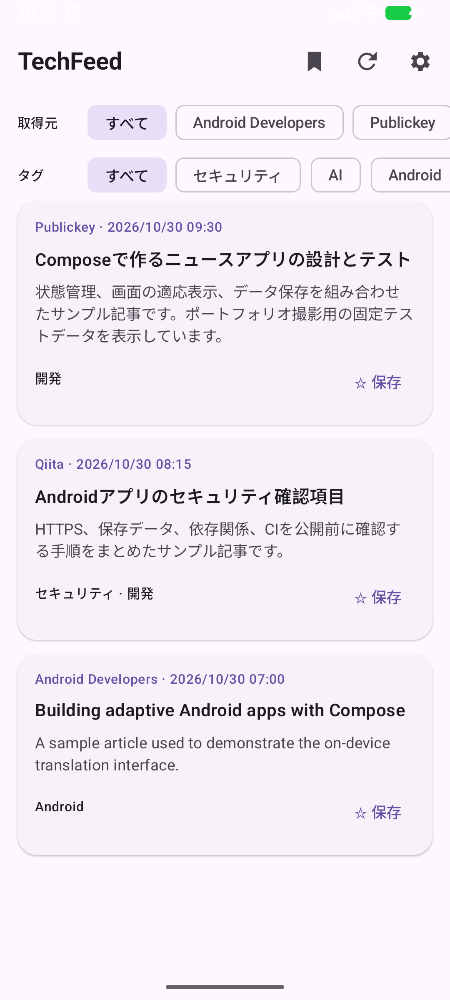
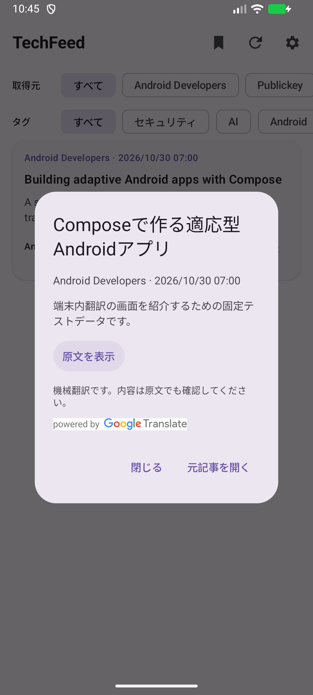
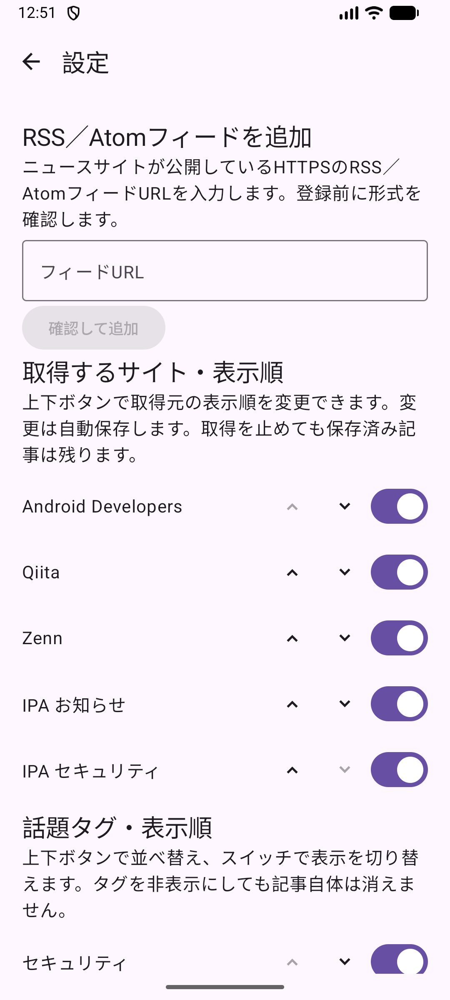

# TechFeed

IT ニュースの取得・絞り込み・保存・翻訳に対応した Android アプリ。

## 画面

| ニュース一覧 | 日本語翻訳 | 取得元・タグの設定 |
| --- | --- | --- |
|  |  |  |

固定テストデータを表示した Android エミュレーター（API 37）で撮影。

## 機能

- 権利条件を確認した5フィードから RSS／Atom を取得
- HTTPSのRSS／Atomフィードを設定から追加・削除
- 取得元・話題タグによる絞り込み
- 記事の一時保存（タイトル・概要のみ）
- 取得元・タグの表示設定と並べ替え
- タグ名と判定キーワードによるカスタムタグの追加・削除
- 英語記事の日本語翻訳（ML Kit、端末内処理）

- 標準配信元：Android Developers、Qiita、Zenn、IPA お知らせ、IPA セキュリティ。
  - カスタム配信元には、利用者自身が利用条件を確認したRSS／Atomフィードの登録を推奨。
  - 本アプリは登録されたフィードを端末から直接取得し、記事本文は配信元のページで表示。

- 標準の話題タグ：
  - セキュリティ、AI、Android、Web、モバイル、クラウド・インフラ、バックエンド・API、データベース、開発ツール、プログラミング、ITニュース、お知らせ。
  - カスタムタグは、指定したキーワードを記事タイトルと概要に照合。

## 技術構成

| 対象 | 使用技術 |
| --- | --- |
| 画面 | Kotlin、Jetpack Compose、Material 3 |
| 状態管理・DI | ViewModel、StateFlow、Coroutines、Hilt |
| 保存・設定 | Room、DataStore |
| 翻訳| ML Kit|
| テスト | JUnit、Compose Test、Espresso |

## テスト

プロジェクト直下で実行。

```sh
./scripts/check-language.sh  # lint・JUnit・debug ビルド
./scripts/check-android.sh   # AndroidTest（端末接続が必要）
```

GitHub Actions：PR・develop／main への push で lint・JUnit・debug ビルドを実行。検証レポートを7日間保存。

コミット前フック：pre-commit と Gitleaks の導入後、`pre-commit install`。GitHub Actions でも履歴を検査。

## 制約

- Android 8.0 (Oreo)以上（API 26）
- 更新は起動時・手動操作時のみ
- 全文保存・ログイン・端末間同期は未対応
- 翻訳モデルは初回ダウンロードが必要
- カスタム配信元はHTTPSのフィードURLを直接指定（Webサイトからの自動検出は未対応）
- 話題タグはキーワード等による簡易判定

## ドキュメント

- [仕様](docs/requirements.md)
- [構成](docs/architecture.md)
- [依存性の注入](docs/hilt-di.md)
- [Android テスト](docs/android-tests.md)

## ライセンス

[MIT License](LICENSE)
