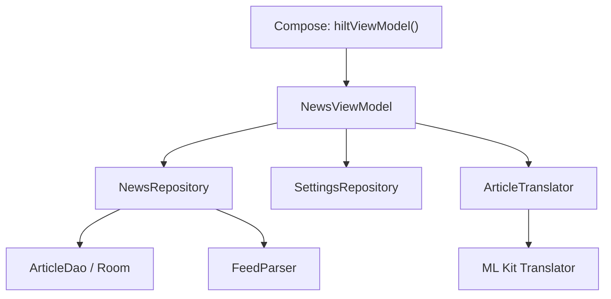

# Hilt による依存性の注入

## ViewModel への依存の注入

NewsViewModel は、記事取得・保存、設定、翻訳の各サービスをコンストラクターで受け取ります。Hilt が依存関係の生成と受け渡しを管理します。

```kotlin
@HiltViewModel
class NewsViewModel @Inject constructor(
    private val repository: NewsRepository,
    private val settingsRepository: SettingsRepository,
    private val translator: ArticleTranslator
) : ViewModel()
```

重要なのは、引数で受け取る部分が DI であり、アノテーションとコード生成でそれを組み立てる部分が Hilt、という区別です。DI 自体は Hilt なしでも行えます。

## 生成のつながり



- NewsRepository は DAO とパーサーを受け取り、DB を探したりパーサーを作ったりしません。
- SettingsRepository は DataStore を受け取ります。SettingsModule が ApplicationContext を使って本番の DataStore を提供します。
- ArticleTranslator は外部ライブラリの Translator を受け取り、翻訳処理を担当します。
- StorageModule と TranslationModule が、外部ライブラリのオブジェクトの生成方法を教えます。

## 構成ファイル

1. TechFeedApplication.kt の @HiltAndroidApp：Hilt の開始点。Manifest にこの Application を登録しています。
2. MainActivity.kt の @AndroidEntryPoint と app/TechFeedApp.kt の hiltViewModel()：Android／Compose と Hilt の接続。
3. feature/news/ui/NewsViewModel.kt の @HiltViewModel、@Inject constructor：必要な依存の宣言。
4. feature/news/data/NewsRepository.kt と data/remote/FeedParser.kt：自分で書いたクラスは @Inject constructor で生成方法を指定。
5. core/di/StorageModule.kt：Room の DB と DAO は @Provides で生成。
6. feature/translation/di/TranslationModule.kt：ML Kit Translator は @Provides で生成。
7. feature/settings/data/SettingsRepository.kt、feature/settings/di/SettingsModule.kt、feature/translation/data/ArticleTranslator.kt：DataStoreの提供と共有範囲。

@Module は生成方法をまとめる場所、@InstallIn はその生成方法を登録するコンポーネント、@Provides は生成する関数です。@ApplicationContext は、Activity の Context と区別してアプリの Context を渡すための修飾子です。

## オブジェクトの寿命

| 指定 | このアプリの対象 | 共有範囲 |
|---|---|---|
| @Singleton | NewsDatabase、NewsRepository、SettingsRepository | アプリの SingletonComponent 内で共有 |
| @ViewModelScoped | ArticleTranslator、ML Kit Translator | 一つの ViewModelComponent 内で共有 |
| スコープなし | FeedParser、ArticleDao の提供関数 | 同一インスタンスを共有する保証は付けない |

DB の手書きの static 相当の保持処理は取り除き、Hilt に任せています。DB名は news.db、スキーマは version 1 のままで、既存の保存記事を使います。

翻訳クライアントは ViewModel の終了時に close() します。@ViewModelScoped を付けるだけでは、自動的に close() は呼ばれません。共有インスタンスを閉じて別の画面を壊さないよう、アプリ全体の Singleton にはしていません。

## Android Studio で確認する

- NewsViewModel の init にブレークポイントを置いて起動すると、コンストラクター引数に Repository と Translator が渡されていることを確認できます。
- Repository のコンストラクターにブレークポイントを置くと、画面コードから直接生成していないことを追えます。
- ビルド後の app/app/build/generated 配下に、feature/news/ui/NewsViewModel_Factory や DaggerTechFeedApplication_HiltComponents_SingletonC などの生成コードがあります。これらはビルド時に生成されるため、直接編集しません。
- 通常の単体テストの FeedParser() は、そのまま使えます。@Inject を付けても、Hilt 経由でしか生成できなくなるわけではありません。

不足する依存の生成方法があると Hilt のコンパイル時に検出されます。動作を試すために意図的に設定を壊す必要はありません。

Repository は具象クラスを注入しています。テスト用の実装への差し替えが必要になった場合は、interface の導入を検討します。

## ビルド設定と参考

- Hilt 2.60.1、AndroidX Hilt Compose 1.3.0 を追加。
- Hilt の KSP サポートに合わせて KSP 2.3.6 → 2.3.9 に更新。
- AGP と Compose のバージョンは既存のものを使用。
- https://dagger.dev/hilt/gradle-setup
- https://dagger.dev/dev-guide/ksp.html
- https://developer.android.com/training/dependency-injection/hilt-jetpack

## 導入時の検証

Android Studio で Hilt の集約・コンポーネント生成を含む assembleDebug、testDebugUnitTest、lintDebug を実行しました。単体テスト20件は失敗0件、lintはエラー0件・警告17件です。警告は主にSDK／依存ライブラリの更新案内、アイコン設定、KTXの推奨であり、抑制は追加していません。秘密情報検査も成功しました。

実際の生成コードでは NewsViewModel_Factory.get() が各 Provider から依存を取得し、new NewsViewModel(repository, settingsRepository, translator) を呼んでいます。自分の画面コードの代わりに Hilt が組み立てている部分です。

Hilt 導入後のAPKをエミュレーターにインストールし、ニュース一覧の起動・表示も確認しました。個別の保存・設定・翻訳操作の再検証は今回のDI導入確認には含めていません。
